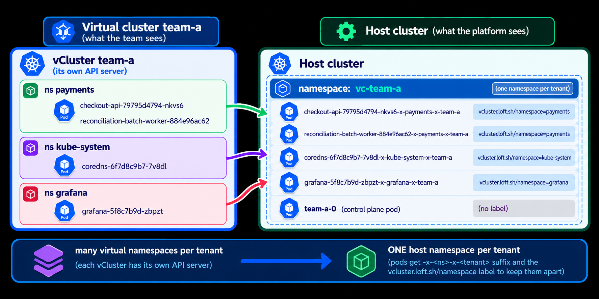
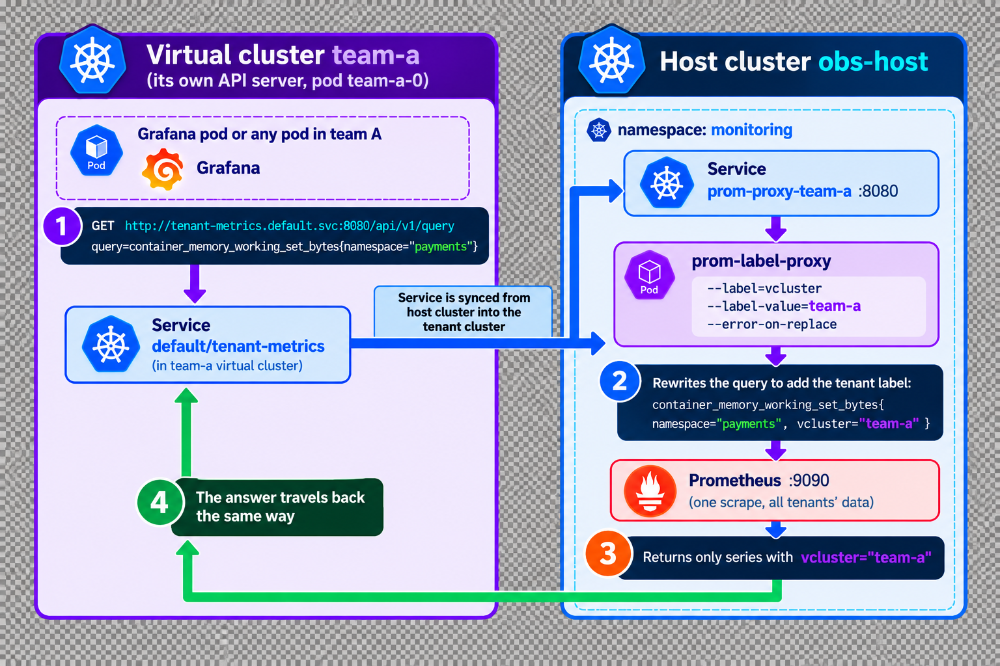
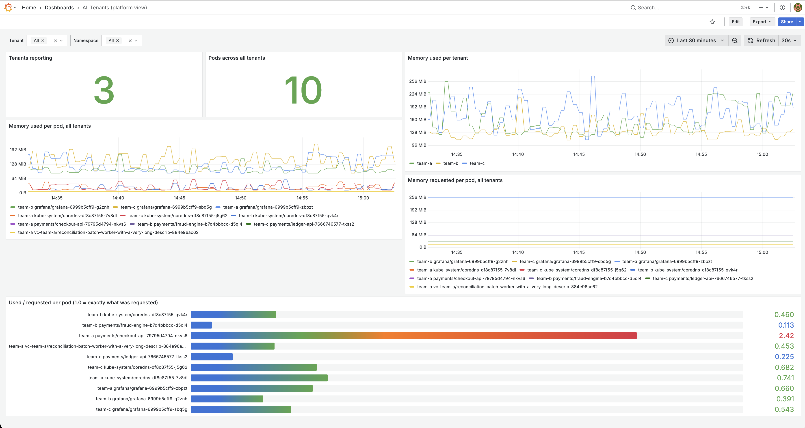

# One Prometheus, Many Virtual Clusters: How Syncing Gives Every Team Its Own Metrics

Every team on your platform is either paying for memory it never uses, or about to run out of memory that nobody warned it about. Without per-team metrics, you can't tell which. And the usual fix, a Prometheus inside every tenant, multiplies your monitoring footprint and gives each tenant control plane a way into your host.

Another challence is to bootstrap the metrics stack in temporary tenants that are spun up during CI runs, preview environments or are killed frequently.

In this article, you'll learn how to scrape once, give every team a locked view of only its own data, and send every alert to the team that owns it and just let temporary tenants work with exporting metrics without having to have one inside them.

It is written for platform engineers and SREs who run many teams on virtual clusters, created with the open-source tool vCluster.

By the end, you'll have a three-tenant lab you can reproduce on a laptop, and you'll know:

- how to give each tenant a read-only endpoint and a Grafana that cannot see anyone else,
- how to compare requested with used, and alert on it,
- what it costs, measured, and where it stops working.
- do all the above from a single grafana instance on the host vCluster

---

## Table of Contents

1. [Prerequisites](#prerequisites)
2. [Why Per-Tenant Metrics Matter](#why-per-tenant-metrics-matter)
3. [How Virtual Clusters Sync Tenant Resources onto the Host](#how-virtual-clusters-sync-tenant-resources-onto-the-host)
4. [How to Teach Prometheus to Speak Tenant](#how-to-teach-prometheus-to-speak-tenant)
5. [How to Lock Each Tenant Behind Its Own Door](#how-to-lock-each-tenant-behind-its-own-door)
6. [How to Build the Lab](#how-to-build-the-lab)
7. [Requested vs Used, Per Tenant](#requested-vs-used-per-tenant)
8. [How to Give Each Tenant a Dashboard That Cannot Leak](#how-to-give-each-tenant-a-dashboard-that-cannot-leak)
9. [Alerts That Reach the Right Team](#alerts-that-reach-the-right-team)
10. [How to Verify the Setup](#how-to-verify-the-setup)
11. [Common Issues and How to Solve Them](#common-issues-and-how-to-solve-them)
12. [When You Outgrow This](#when-you-outgrow-this)
13. [Conclusion](#conclusion)

---

## Prerequisites

You need a laptop with Docker and the tools below, at the versions the lab was tested with. Other versions may work, but I didn't test them.

| Component                                              | Version                                       |
| ------------------------------------------------------ | --------------------------------------------- |
| vCluster CLI                                           | 0.36.1                                        |
| Kubernetes (host)                                      | v1.35.0                                       |
| Kubernetes (tenant virtual clusters, vCluster default) | v1.36.0                                       |
| kube-prometheus-stack chart                            | 92.9.0 (Prometheus Operator v0.94.1)          |
| kube-state-metrics                                     | 2.20.0                                        |
| prom-label-proxy                                       | v0.11.0                                       |
| Grafana                                                | 12.0.2                                        |
| Helm                                                   | 4.2.0                                         |
| kubectl                                                | 1.35.0                                        |
| Docker                                                 | 29.4.0                                        |
| Python 3                                               | 3.13 (only used by `verify.sh` to parse JSON) |

You should know basic Kubernetes objects and familiarity with vCluster in regards with host and tenant cluster is expected.

The code lives in the companion repo. Every command below is wrapped in `setup.sh` and `verify.sh`, so you can follow along or just run them.

---

## Why Per-Tenant Metrics Matter:

vCluster helps virtualise Kuberetes Control Planes. The setup we'd be building has one host cluster and three tenant clusters.

When teams get their own virtual cluster, the obvious next step is to give them their own monitoring. It feels clean: a Prometheus in every virtual cluster, dashboards per team, no shared state.

The cost isn't only memory, since every new tenant adds another stack to patch, secure and watch. In the lab, three tenant stacks used about 545 MiB, against 400 MiB for one shared stack. The growth is what matters: each new tenant adds roughly 170 to 190 MiB as its own stack, and very little to the shared one.

Also, for temporary tenants that are spun up during CI runs, preview environments or are killed frequently, setting up a new Prometheus stack for each tenant is not practical. You create a virtual cluster, install the monitoring stack, runs the app to export metrics and then destroy the virtual cluster. Doing this for every tenant becomes a nightmare.

There has to be a better and more efficient way to do this..

It is with one Prometheus on the host. Because the pods running inside the vcluster are actually running on the host, you can scrape them with one Prometheus.

The only challenge is that this setup works until you look at what prometheus stores. It stores metrics for virtual clusters created on the tenants' behalf, under names the tenants have never seen.

Every metric carries a `pod` and `namespace` labels with values a team doesn't recognise, so a dashboard built on them is useless to a team.

Once you solve this properly, the teams can see where they waste resources and where they are about to run out.

The problem splits in two. First, translate what the host sees into what a tenant expects. Second, make sure a tenant can only ask for its own data.

By the end, our setup would look something as follows.


## Problem 1: Same pod, two views

A pod can be viewed in two different ways: from the perspective of the tenant and from the perspective of the platform team.

A pod named `mypod` in namespace `mynamespace` in virtual cluster `myvcluster` when checked from the perspective of the tenant will be named `mypod` on the tenant cluster and `mypod-x-mynamespace-x-myvcluster` on the host.

This naming convention is used by vCluster. It's a way to help platform engineers to identify the pod's virtual cluster when looking at the host cluster.

Internally, vCluster also adds two labels to the pod: `vcluster.loft.sh/name` and `vcluster.loft.sh/namespace` to help with the identification.

Here are team A's pods as the team sees them (`showsync.sh` in the repo prints all of this for any tenant):

```bash
vcluster connect team-a -n vc-team-a --driver helm --context vcluster-docker_obs-host -- \
  kubectl get pods -A
```

```text
NAMESPACE     NAME                                                            READY   STATUS
grafana       grafana-84dcb74c69-7k2hq                                        1/1     Running
kube-system   coredns-df8c87f55-7v8dl                                         1/1     Running
payments      checkout-api-79795d4794-nkvs6                                   1/1     Running
payments      reconciliation-batch-worker-with-a-very-long-descriptive-name   1/1     Running
```

And the same pods as the platform team sees them on the host:

```bash
kubectl --context vcluster-docker_obs-host -n vc-team-a get pods \
  -o custom-columns=NAME:.metadata.name,STATUS:.status.phase,NODE:.spec.nodeName
```

```text
NAME                                                              STATUS    NODE
checkout-api-79795d4794-nkvs6-x-payments-x-team-a                 Running   worker-1
coredns-df8c87f55-7v8dl-x-kube-system-x-team-a                    Running   obs-host
grafana-84dcb74c69-7k2hq-x-grafana-x-team-a                       Running   worker-2
reconciliation-batch-worker-with-a-very-long-descrip-884e96ac62   Running   worker-1
team-a-0                                                          Running   obs-host
```

Each virtual cluster gets one namespace on the host, here `vc-team-a`.

Inside the virtual cluster, team A has three namespaces with pods (`payments`, `grafana`, `kube-system`), but on the host, all of those pods from all namespaces of the virtual cluster sit side by side in `vc-team-a` namespace.

The extra pod, `team-a-0`, is the virtual cluster's own control plane.

This is how they'd look side by side.



Now the part that shows what "virtual" means. The team has a Deployment called `checkout-api`. Ask the host for Deployments:

```bash
kubectl --context vcluster-docker_obs-host -n vc-team-a get deploy
```

```text
No resources found in vc-team-a namespace.
```

The Deployment doesn't exist on the host. Only the Pod does.

### What lives where

| Object             | Tenant sees                               | Host sees                                                  |
| ------------------ | ----------------------------------------- | ---------------------------------------------------------- |
| Namespace          | `payments`, `grafana`, `kube-system`, ... | one per virtual cluster: `vc-team-a` holds all of team A's |
| Pod                | `checkout-api-79795d4794-nkvs6`           | `checkout-api-79795d4794-nkvs6-x-payments-x-team-a`        |
| Deployment         | yes                                       | no                                                         |
| Service            | `grafana`, ClusterIP `10.104.206.84`      | `grafana-x-grafana-x-team-a`, same ClusterIP               |
| ConfigMap          | `kube-root-ca.crt` in each namespace      | `kube-root-ca.crt-x-payments-x-team-a`, and so on          |
| Kubernetes version | v1.36.0                                   | v1.35.0                                                    |

Look at the last row: the tenant's API server runs Kubernetes v1.36.0 on a host that runs v1.35.0. Sync also runs the other way, and you'll use that later to replicate a host Service into each virtual cluster.

## How Virtual Clusters Sync Tenant Resources onto the Host

For a pod that lives in a virtual cluster, the host fills in values that a tenant doesn't recognise, as you just saw. To understand why, you need to know what a virtual cluster does with a tenant's pod.

A virtual cluster is not a namespace with fancy permissions. It has its own control plane: Its own API server, its own data store, running as a single pod called `team-a-0` on the host. When a team runs `kubectl apply`, it talks to that API server, and what it creates lives there. Deployments, namespaces, ConfigMaps, all of it.

But a control plane can't run containers. Somebody has to put them on a real machine. So vCluster runs a syncer that copies down only the objects that need a real node, mainly Pods, and leaves the rest where they are.


### The Flow

1. A team creates a Deployment in its own virtual cluster. It is stored in the tenant's API server only.
2. Inside the tenant, the Deployment produces a Pod object.
3. The syncer copies the Pod to the host namespace `vc-team-a` under a translated name.
4. The host places it on a real node, and the kubelet runs it.
5. Status flows back, so the tenant sees `Running` in its own cluster.

### Why this matters for metrics

If you are a tenant inside your virtual cluster, you'd expect to see the pod named `mypod` in the namespace `mynamespace` instead of `mypod-x-mynamespace-x-myvcluster` in your metrics and dashboards. The later name makes no sense to you.

This is where we need to transform / relabel the metrics and dashboards to make them readable by the tenant, giving them the name of the resources and metrics they expect.

This design is why the rest of the article works:

- **Pods are real host pods.** One cAdvisor and one kube-state-metrics on the host see every tenant, so you can scrape once.
- **The names are translated.** The host sees `-x-payments-x-team-a`, so you need relabeling to give tenants their names back.
- **A tenant can't reach host objects.** A proxy is the only door you need to lock.

### When the name is too long

There is one edge case you need to know about before it surprises you in production. Kubernetes limits object names to 63 characters. When the translated name would be longer, vCluster shortens it and appends a hash. In the lab, a pod called `reconciliation-batch-worker-with-a-very-long-descriptive-name` became:

```text
reconciliation-batch-worker-with-a-very-long-descrip-884e96ac62
```

That name is exactly 63 characters and contains no `-x-`. In this lab, vCluster ended it with a dash and ten hex characters. Anything that parses the name will not match it. You'll handle this explicitly in the next section.

---

## How to Teach Prometheus to Speak What the Tenant Sees

When Prometheus scrapes the host, it records the host's names. For team A's checkout-api it stores this:

pod = checkout-api-79795d4794-nkvs6-x-payments-x-team-a
namespace = vc-team-a

Team A doesn't recognise either. For them the pod name is `checkout-api-79795d4794-nkvs6` and the namespace is `payments`. If they query for `namespace="payments"`, they get nothing.

The fix is to rewrite the labels to the tenant's expected values.

Prometheus can rewrite a metric's labels at the moment it stores it. These rewrite rules are called relabeling rules. The section adds rules that read the host name and cut it back into the pieces the tenant expects:

So the original:

```text
pod = checkout-api-79795d4794-nkvs6-x-payments-x-team-a
namespace = vc-team-a
```

becomes:

```text
pod = checkout-api-79795d4794-nkvs6
namespace = payments
vcluster = team-a (new label, tells the teams apart)
```

Which is what the tenants expect to see in their metrics and dashboards.

Two data sources matter, and they answer different questions:

- **cAdvisor**, served by the kubelet, reports what a container is actually using. Example: `container_memory_working_set_bytes`.
- **kube-state-metrics (KSM)** reports what Kubernetes says should be true. Example: `kube_pod_container_resource_requests`.

"Requested versus used" divides one by the other, so both must carry identical labels. If you relabel only cAdvisor, the labels on the two sides do not line up and the division has nothing to join.

The rules live in a Helm values file, and YAML anchors let you write them once and apply them to both sources:

```yaml
x-vcluster-relabelings:
  &vclusterRelabelings # Fallback for pods whose host name was shortened with a hash
  - sourceLabels: [namespace, pod]
    regex: vc-(.+);.+-[0-9a-f]{10}
    targetLabel: vcluster
    replacement: $1
  # Keep the physical coordinates for platform engineers
  - sourceLabels: [pod]
    regex: (.+-x-.+-x-.+)
    targetLabel: host_pod
    replacement: $1
  - sourceLabels: [namespace, pod]
    regex: (.+);.+-x-.+-x-.+
    targetLabel: host_namespace
    replacement: $1
  # Split the translated name into tenant labels
  - sourceLabels: [pod]
    regex: .+-x-.+-x-(.+)
    targetLabel: vcluster
    replacement: $1
  - sourceLabels: [pod]
    regex: .+-x-(.+)-x-.+
    targetLabel: namespace
    replacement: $1
  - sourceLabels: [pod]
    regex: (.+)-x-.+-x-.+
    targetLabel: pod
    replacement: $1

kubelet:
  serviceMonitor:
    cAdvisorMetricRelabelings: *vclusterRelabelings

kube-state-metrics:
  prometheus:
    monitor:
      metricRelabelings: *vclusterRelabelings
```

**Note:** Order matters. The `host_` rules run first because the later rules overwrite `pod` and `namespace`. If you reorder them, you lose the original values.

In kube-prometheus-stack, the cAdvisor rules go under the kubelet's own key, `cAdvisorMetricRelabelings`.

---

## Problem 2: How to Lock Each Tenant Behind Its Own Door

Now the harder half. You have clean labels, but tenants must only see their own.

The tempting shortcut is to expose the host Prometheus service to every virtual cluster.

This is fine if you have an open policy in the organisation. In some organisations, everyone has access to all the data in the name of openess and transparency.

But many organisations do not have an open policy. They want to be able to control who has access to their data. If so, do not expose the host Prometheus service to every virtual cluster. Any tenant could then read another team's data, and the admin API and config endpoint would be reachable too.

The standard tool for this is `prom-label-proxy`. It sits in front of the host Prometheus and rewrites every query from tenant pods so that it only matches series with a chosen label value.

To isolate requests per tenant, the prometheus queries originating from tenant pods need a label and a value that is unique per tenant.

In our case, the label is `vcluster` and the value is the name of the tenant, such as `team-a`. A tenant should not be able to choose another team's name, as if they can, that is not isolation at all.

The solution is to hardcode the value on the proxy per tenant. In v0.11.0, the `--label` and `--label-value` flags do that.

You run one proxy per tenant. For instance, for team A:

```yaml
containers:
  - name: proxy
    image: quay.io/prometheuscommunity/prom-label-proxy:v0.11.0
    args:
      - --insecure-listen-address=0.0.0.0:8080
      - --upstream=http://kube-prom-kube-prometheus-prometheus.monitoring.svc:9090
      - --label=vcluster
      - --label-value=team-a
      - --error-on-replace
      - --enable-label-apis
```

And for team B:

```yaml
containers:
  - name: proxy
    image: quay.io/prometheuscommunity/prom-label-proxy:v0.11.0
    args:
      - --insecure-listen-address=0.0.0.0:8080
      - --upstream=http://kube-prom-kube-prometheus-prometheus.monitoring.svc:9090
      - --label=vcluster
      - --label-value=team-b
      - --error-on-replace
      - --enable-label-apis
```

`--label=vcluster` and `--label-value=team-a` pins the tenant.

`--error-on-replace` makes the proxy return an error when a query already contains a conflicting matcher, instead of silently rewriting it.

So, a prometheus query from a tenant pod will look like this:

```promql
container_memory_working_set_bytes{namespace="payments",container="app"}
```

And the proxy will rewrite it to:

```promql
container_memory_working_set_bytes{namespace="payments",container="app",vcluster="team-a"}
```

and then further forward it to the host Prometheus.

One more important thing. People usually run same workloads in different clusters and the rollouts are controlled via argocd. So it's natural to have same namespace in every tenant cluster.

This is also what we have in the lab, every tenant runs its workload in a namespace called `payments`. Kubernetes has no problem with this, because each virtual cluster has its own namespaces.

The problem is however on the host. Because the namespace `payments` is common across all the tenant clusters, the query `container_memory_working_set_bytes{namespace="payments"}` would return `checkout-api`, `fraud-engine` and `ledger-api` together, one per team.

That is what breaks naive dashboards. The `vcluster` label keeps them apart. The proxy adds it to every tenant query, and on the host you add it yourself, for example `{namespace="payments",vcluster="team-a"}`.

The last step is to bring each proxy into its own virtual cluster, so tenant pods reach it with a normal in-cluster address. vCluster can replicate a host service into a virtual cluster. In vCluster 0.36.1 that is configured under `networking.replicateServices.fromHost`:

```yaml
networking:
  replicateServices:
    fromHost:
      - from: monitoring/prom-proxy-team-a
        to: default/tenant-metrics
```

Inside team A's virtual cluster, any pod can now call `http://tenant-metrics.default.svc:8080`. Team B has the same address, and it leads to a different proxy.

The flow of the request after the proxy is added is as follows:



---

## How to Build the Lab

<!-- ### The Flow -->

<!-- 1. The host Prometheus scrapes cAdvisor and kube-state-metrics once, and relabeling rewrites host names into `pod`, `namespace`, and `vcluster`.
2. Recording rules divide usage by requests per tenant.
3. A pod or Grafana inside a virtual cluster calls `tenant-metrics.default.svc:8080`, the replicated host proxy for that tenant.
4. The proxy adds `vcluster="team-a"` to the query and forwards it to Prometheus. The tenant cannot change that value.
5. When an alert fires, Alertmanager routes it by the `vcluster` label to that team's receiver. -->

### Create the host cluster

The lab runs on a local cluster. It uses vCluster's own Docker driver to create a host with one control plane and two workers.

```bash
vcluster create obs-host --driver docker -f vcluster.yaml
```

**Note:** Every command in the lab passes the explicit kube context `vcluster-docker_obs-host`. Your kubeconfig probably contains more important clusters, so never rely on the current context for something that installs software.

### Install the monitoring stack

```bash
helm repo add prometheus-community https://prometheus-community.github.io/helm-charts
helm upgrade --install kube-prom prometheus-community/kube-prometheus-stack \
  --version 92.9.0 --kube-context vcluster-docker_obs-host -n monitoring --create-namespace \
  -f prom-values.yaml --wait
```

### Create the tenants

```bash
for t in team-a team-b team-c; do
  vcluster create $t -n vc-$t --driver helm --context vcluster-docker_obs-host \
    -f tenants/vcluster-$t.yaml --connect=false
done
```

Each tenant also gets a small Grafana inside its virtual cluster. That part is explained in its own section below.

Everything in this section is scripted. `./setup.sh` runs the lot, and it is safe to run again.

---

## Requested vs Used, Per Tenant

After a minute or two, ask the host Prometheus for the same pod as a platform engineer would:

```promql
container_memory_working_set_bytes{namespace="payments", container="app"}
```

Here is what comes back for team A:

```text
{'pod': 'checkout-api-79795d4794-nkvs6', 'namespace': 'payments', 'vcluster': 'team-a',
 'host_pod': 'checkout-api-79795d4794-nkvs6-x-payments-x-team-a', 'host_namespace': 'vc-team-a'}
```

The `pod`, `namespace`, and `vcluster` labels are what a tenant expects, and the `host_*` labels point platform engineers at the physical pod. The same query on `kube_pod_container_resource_requests` returns the same labels, so the two can be divided.

Recording rules do the division once, so dashboards and alerts do not repeat it:

```yaml
- record: vcluster:pod_memory_usage_bytes
  expr: sum by (vcluster, namespace, pod) (container_memory_working_set_bytes{container!="", vcluster!=""})
- record: vcluster:pod_memory_requests_bytes
  expr: sum by (vcluster, namespace, pod) (kube_pod_container_resource_requests{resource="memory", vcluster!=""})
- record: vcluster:pod_memory_usage_over_request:ratio
  expr: vcluster:pod_memory_usage_bytes / vcluster:pod_memory_requests_bytes
```

The lab gives each workload a different memory request on purpose. Team A requests 3Mi, team B 64Mi, and team C 32Mi. Querying the ratio returns:

```text
team-a checkout-api-79795d4794-nkvs6   usage/request = 2.40
team-b fraud-engine-b7d4bbbcc-d5ql4    usage/request = 0.11
team-c ledger-api-7666746577-tkss2     usage/request = 0.22
```

Team A uses more than twice what it asked for. Team B uses about a tenth, a right-sizing candidate. Neither is visible from `kubectl top` alone.

---

## How to Give Each Tenant a Dashboard That Cannot Leak

Most teams want a dashboard, which raises a question: where does Grafana live?

The tempting answer is one Grafana on the host, since all the metrics are already there. It does not work for tenants. And frankly, this is what I have at work. This is not such a bad idea if your metrics are open to everyone. Keeps the setup simple and allows you to share the dashboard with the whole organization.

But for the other case, a datasource is a doorway to everything behind it, so with the host Prometheus behind it, a dashboard variable such as `vcluster="team-a"` is only decoration.

Anyone with Editor rights can open Explore, remove the filter, and read every tenant. Per-tenant datasource permissions are, to my knowledge, an Enterprise feature, and the open-source alternative is one organization per tenant, administered by hand.

The lab takes a simpler road: run a Grafana inside each virtual cluster and give it one datasource, the locked endpoint the tenant already has.

```yaml
datasources:
  - name: Tenant Metrics
    uid: tenant-prom
    type: prometheus
    access: proxy
    url: http://tenant-metrics.default.svc:8080
    isDefault: true
    editable: false
```

Even if a tenant is Grafana admin and changes every setting, the only door Grafana can knock on is the proxy with the fixed label.

The dashboard is a JSON file shipped as a ConfigMap and loaded through Grafana's provisioning. It uses the recording rules from the previous section and has three panels: memory used per pod, memory requested per pod, and a used-over-requested bar that turns orange near 1.0 and red above 1.2.

A `namespace` variable fills itself through the proxy's label APIs, scoped to the tenant. You can see the added label vcluster="team-a" in the metrics. This was added by the proxy before sending the request to the host Prometheus.

To open it as team A:

```bash
vcluster connect team-a -n vc-team-a --driver helm --context vcluster-docker_obs-host -- \
  kubectl port-forward -n grafana svc/grafana 3000:3000
# open http://localhost:3000, user admin, password admin
```

After logging in, you can query the metrics of pods of tenant team-a.


**Note:** The lab sets the Grafana password to `admin` so that you can log in quickly. Use a Secret and your SSO provider in anything real.

`verify.sh` calls each tenant's Grafana from a pod in that tenant and asks the datasource which tenants exist:

```text
PASS  team-a Grafana datasource is healthy  ["status":"OK"]
PASS  team-a Grafana lists only its own tenant  [{"status":"success","data":["team-a"]}]
PASS  team-a dashboard is provisioned  [200]
```

Teams B and C return the same with their own names.

A query for `vcluster="team-b"` sent through team A's Grafana gets the same conflicting-matcher error as before and is denied.


The cost is one Grafana per tenant, which is definitely high compared to a singular host grafana instance. Keep one more on the host for the platform teams if you need to, pointed at the unfiltered Prometheus, to compare tenants.

Multiple tenant Grafana instances leads to different URLs. You can use a wildcard DNS record to point to the Grafana instances for teams, so `grafana.team-a.example.com` points to team-a's Grafana and so on.

---

## Alerts That Reach the Right Team

A number on a dashboard is useful. A message in the right channel is better.

One rule in the lab fires when a pod uses more than 90 percent of its memory request for a minute:

```yaml
- alert: TenantPodMemoryAboveRequest
  expr: vcluster:pod_memory_usage_over_request:ratio > 0.9
  for: 1m
  labels:
    severity: warning
```

Because every series carries a `vcluster` label, routing is a few lines of Alertmanager configuration:

```yaml
route:
  receiver: platform
  group_by: [alertname, vcluster]
  routes:
    - receiver: team-a
      matchers:
        - vcluster="team-a"
    - receiver: team-b
      matchers:
        - vcluster="team-b"
    - receiver: team-c
      matchers:
        - vcluster="team-c"
      receiver: team-c

receivers:
  - name: team-a
    slack_configs:
      - api_url: "https://dummy.slack.endpoint/team-a"
        channel: "#team-a-alerts"
        send_resolved: true
  - name: team-b
    slack_configs:
      - api_url: "https://dummy.slack.endpoint/team-b"
        channel: "#team-b-alerts"
        send_resolved: true
  - name: team-c
    slack_configs:
      - api_url: "https://dummy.slack.endpoint/team-c"
        channel: "#team-c-alerts"
        send_resolved: true
```

The lab uses a tiny webhook echo server as the receiver, so you can see which team got which alert. In real life these would be Slack channels or on-call schedules.

If you'd check the logs of the echo server, you'd see the alert firing for team A and the other teams staying quiet.

```bash
kubectl --context vcluster-docker_obs-host -n monitoring logs -f  alert-sink-68f8cdc4fb-m2pgf
```

```text
{
    "path": "/team-a",
    "method": "POST",
    "json": {
        "receiver": "team-a",
        "status": "firing",
        "alerts": [
            {
                "status": "firing",
                "labels": {
                    "alertname": "TenantPodMemoryAboveRequest",
                    "namespace": "payments",
                    "pod": "checkout-api-79795d4794-nkvs6",
                    "prometheus": "monitoring/kube-prom-kube-prometheus-prometheus",
                    "severity": "warning",
                    "vcluster": "team-a"
                },
                "annotations": {
                    "summary": "payments/checkout-api-79795d4794-nkvs6 uses 241.8% of its memory request"
                },
                "startsAt": "2026-10-22T08:00:28.505Z",
                "endsAt": "0001-01-01T00:00:00Z",
                "generatorURL": "http://kube-prom-kube-prometheus-prometheus.monitoring:9090/graph?g0.expr=vcluster%3Apod_memory_usage_over_request%3Aratio+%3E+0.9&g0.tab=1",
                "fingerprint": "0c48f315495bdda8"
            }
        ],
    }
}
```

Team A's pod is at 2.40 times its request, so the alert fires for team A. Teams B and C stay quiet, and the sink only ever receives a delivery on `/team-a`.

**Note:** Rules and routes stay platform-owned in the lab. Letting tenants write their own rules is a separate problem, because a rule runs on the host Prometheus and must not read other tenants.

---

## How to Verify the Setup

A tutorial about isolation should prove it. `verify.sh` starts a pod inside team A's virtual cluster and attacks its own metrics endpoint in several ways.

| Attempt from inside team-a                | Result                                    |
| ----------------------------------------- | ----------------------------------------- |
| Normal query for `payments` pods          | Only `vcluster="team-a"` series come back |
| Query that asks for `{vcluster="team-b"}` | HTTP 400, conflicting label matcher       |
| Request with `?vcluster=team-b`           | Parameter ignored, only team-a data       |
| Request with header `X-Vcluster: team-b`  | Header ignored, only team-a data          |
| `/api/v1/series` asking for team-b        | `{"status":"success","data":[]}`          |
| `/api/v1/label/vcluster/values`           | `["team-a"]`                              |
| `/federate` asking for team-b             | Empty response                            |
| `/api/v1/status/config`                   | HTTP 404                                  |
| Admin API delete                          | HTTP 404                                  |

### What does it save?

To measure the saving, I installed a standard Prometheus with kube-state-metrics inside each virtual cluster and compared it with the single host stack. All numbers are five-minute average container working set:

|                                        | Prometheus | KSM    | Stack total | Head series   |
| -------------------------------------- | ---------- | ------ | ----------- | ------------- |
| Host (one instance, all three tenants) | 375 MiB    | 25 MiB | 400 MiB     | 68,578        |
| team-a                                 | 158 MiB    | 25 MiB | 182 MiB     | 46,179        |
| team-b                                 | 146 MiB    | 25 MiB | 171 MiB     | 44,955        |
| team-c                                 | 169 MiB    | 22 MiB | 192 MiB     | 44,261        |
| Three tenant stacks                    |            |        | 545 MiB     | about 135,000 |

At three small tenants the saving is modest: 545 MiB against 400 MiB, about 1.4 times. Don't expect a tenfold reduction at this size.

The overhead does not stay at three tenants. It grows with every tenant you add, because each one brings its own stack, and with every app you deploy, because each app adds series to scrape and store. A rough model shows how. Prometheus memory follows active series, not retention or scrape interval, so those two cost disk and CPU instead.

```text
N  tenants                           F  fixed cost of one stack (about 170 MiB in the lab)
S  series per tenant                 b  memory per series (assume about 4 KB)
D  series each tenant stack scrapes again (shared sources such as node cAdvisor)
p  one proxy (32 MiB request in the lab, a ceiling)

Prometheus per tenant   N * (F + (S + D) * b)
One shared Prometheus   F + N * S * b + N * p
Saving                  (N - 1) * F + N * D * b - N * p
```

The tenant data term `N * S * b` is in both lines, so it cancels. More workloads make both designs bigger by the same amount. What the shared setup avoids is the fixed cost repeated for every tenant, and the repeated scraping. With S = 5,000 and D = 3,000 (assumptions, not measurements), it looks like this:

| Tenants | Prometheus per tenant | One shared Prometheus | Saved    |
| ------- | --------------------- | --------------------- | -------- |
| 3       | 0.6 GiB               | 0.3 GiB               | 0.3 GiB  |
| 10      | 2.0 GiB               | 0.7 GiB               | 1.3 GiB  |
| 50      | 9.8 GiB               | 2.7 GiB               | 7.1 GiB  |
| 200     | 39.3 GiB              | 10.2 GiB              | 29.1 GiB |

The three-tenant row is the lab. Disk follows the same shape. One series at a 30 second interval for 15 days is about 65 KB at 1.5 bytes per sample, so halving the interval or doubling retention doubles the disk of both designs. The shared setup also gives you one volume to manage instead of one per tenant.

The shared Prometheus grows too. At 200 tenants it holds about a million series in one process, which is where the last section of this article begins.

**Note:** The comparison is not like-for-like. A default tenant Prometheus also scrapes its own API server and etcd, whose histograms are the biggest series in each tenant, and the host never ingests them. This was a single run, measured in working set and not resident memory.

### Clusters That Come and Go Should Not Each Need a Stack

Memory is one argument. Another is lifecycle. Virtual clusters are cheap, so teams create them for a CI run, a preview environment or a test, and delete them hours later. A Prometheus per virtual cluster means installing and wiring a monitoring stack for something that lives for an afternoon.

```text
Prometheus per virtual cluster                  One shared Prometheus
---------------------------------------------   ----------------------------------------
cluster created, install Prometheus and KSM     cluster created, app starts, already scraped
wait for the first scrape, grant permissions    metrics queryable after one scrape interval
app runs                                        app runs
cluster deleted, its metrics are gone           cluster deleted, its history stays on the host
```

With the shared setup, a new virtual cluster comes up, runs its app, and its metrics appear on the host without installing anything. When the cluster is deleted, you can still ask why last night's run was slow. A stack inside the cluster takes that data with it, unless you add remote storage to every one of them.

Two things still have to exist per cluster, the proxy and the alert route. Written by hand, that is the static setup from earlier. For clusters that come and go, it has to happen on its own.

### How to Automate the Proxy and the Alert Route

The syncer already marks the host namespace of every virtual cluster with the annotation `vcluster.loft.sh/created: "true"`. A policy engine such as Kyverno can use that as a trigger. A `generate` rule with `synchronize: true` creates objects when the namespace appears and removes them when it goes away.

```text
namespace vc-team-x created
        |
        v   Kyverno generate policy
        +--> Deployment and Service  prom-proxy-team-x   (monitoring)
        +--> AlertmanagerConfig      team-x              (monitoring)
                route: vcluster="team-x" -> webhook of team x

namespace vc-team-x deleted, all of it is removed
```

The route is an `AlertmanagerConfig` from the Prometheus Operator, one per tenant, which replaces the static routes in `prom-values.yaml`:

```yaml
apiVersion: monitoring.coreos.com/v1alpha1
kind: AlertmanagerConfig
metadata:
  name: team-x
  namespace: monitoring
spec:
  route:
    receiver: team-x
    matchers:
      - name: vcluster
        value: team-x
  receivers:
    - name: team-x
      webhookConfigs:
        - url: http://alert-sink.monitoring.svc:8080/team-x
```

Three details matter. The policy derives `team-x` from the namespace name by removing `vc-`, the same convention the relabeling already relies on. The webhook URL can come from an annotation on the namespace, with a catch-all route in `prom-values.yaml` so an alert with no destination still reaches the platform team. And by default the operator adds a `namespace` matcher to every route, which would never match here because the relabeling rewrites `namespace`. The Alertmanager has a matcher strategy setting for this, which you need to set to `None`.

**Note:** I did not run this part in the lab. The lab creates the three tenants by hand. The design follows from how Kyverno and the Prometheus Operator work, but check the policy and the matcher setting against the versions you run before relying on them.

### What is there for Platform Engineers?

Platform engineers can still see the metrics of all tenants on the host Prometheus. They can also see the metrics of all tenants in Grafana on the host. They'd need their own locked down Grafana instance installed on the host for this.

This is what the platform engineers see on their grafana instance. They haven access to all tenant metrics.

```text
kubectl --context vcluster-docker_obs-host -n monitoring port-forward svc/grafana-host 3000:3000
```



## Common Issues and How to Solve Them

These are the problems I hit while building the lab.

**Every tenant gets alerts about pods like** `team-a-0`**.** Your tenant fallback rule is too wide. It must only match hashed names.

---

## When You Outgrow This

This design has real limits, and you should know them before you commit.

A single Prometheus is a single point of failure. In the lab, retention is six hours on the pod's local disk, with no high availability and no view across clusters. All tenants also share its memory, so a tenant that creates a huge number of series affects everyone.

If you need any of that, keep scraping once but ship the data elsewhere. Run Prometheus in agent mode, or vmagent, and send the samples to a central store such as VictoriaMetrics.

It also changes the isolation story in a good way. VictoriaMetrics' `vmauth` can inject a label from the caller's token, so a tenant cannot choose its own value. Check the vmauth documentation for the exact syntax in your version.

It costs more components: an agent cannot evaluate alert rules, so you add a rule engine such as vmalert. The relabeling in this post carries over unchanged, because both designs need the rules that translate `-x-` names into tenant labels.

Start with one Prometheus, and move to agents and central storage when you outgrow its availability, retention, or reach.

---

## Conclusion

After implementing this setup, every team can see its own usage next to its own requests, on a dashboard that cannot show anyone else's data. You scrape once, and no tenant got a permission on your host.

You didn't read about multi-tenant observability. You built it, and you measured it. You now have:

1. **A single scrape.** One host Prometheus reads cAdvisor and kube-state-metrics once, however many virtual clusters you add.
2. **Tenant-shaped labels.** Relabeling turns `checkout-api-...-x-payments-x-team-a` into clean `pod`, `namespace`, and `vcluster` labels, with the physical names kept in `host_pod` and `host_namespace`.
3. **A locked door per tenant.** One `prom-label-proxy` per tenant with a fixed `--label-value`, replicated into each virtual cluster as `tenant-metrics`. You proved it with eight attacks.
4. **Requested versus used.** Recording rules divide usage by requests, so a team sees at once that it is at 2.40 times its request or at 0.11.
5. **Dashboards that cannot leak.** A Grafana inside each virtual cluster, whose only datasource is that tenant's locked endpoint.
6. **Alerts that reach the right team.** Routing on the `vcluster` label sends each alert to its owner.
7. **Honest numbers.** 400 MiB shared against 545 MiB for three separate stacks, a gap that grows with every tenant, and a known hashed-name edge case.

To go further, build the annotation join for hashed pods, or move storage to an agent and central store. Run `./verify.sh` after any change to know within a minute whether a tenant still sees only its own metrics.

Your teams stop asking you what they are using. They can look.
